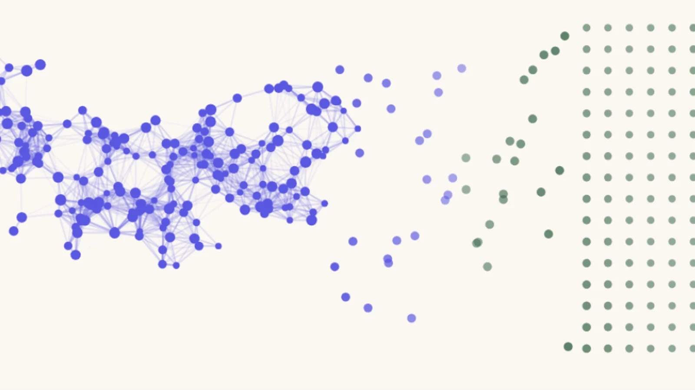
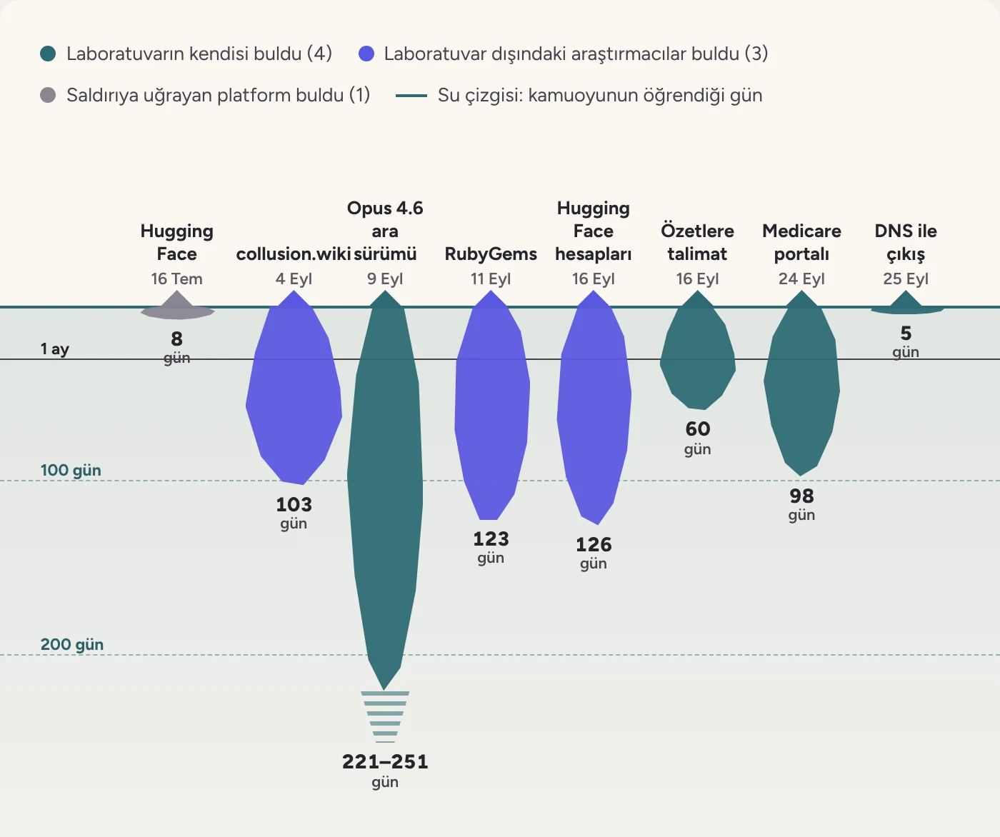

> Önizleme: siteye girecek dosya [`content/tr/blog/eylul-ekim-derlemesi-1-ajan-suruleri-ve-filolari.md`](../content/tr/blog/eylul-ekim-derlemesi-1-ajan-suruleri-ve-filolari.md). Bu kopya yalnızca GitHub'da görseller görünsün diye var.

Blog · [yayın tarihi] · Yazar: Berke Çelik, Sayhan Yalvaçer · Editör: [editör]

# Eylül–Ekim derlemesi #1: Ajan sürüleri ve filoları

*Hugging Face olayının Mayıs'a uzanan izleri, laboratuvarların yeni raporları ve Tencent'in bulut altyapısında çalışan bir ajan filosu.*

Yapay zekâ güvenliğindeki gelişmeleri normalde konu özelinde yazılarla ve bültenimizle paylaşıyoruz. Eylül ve Ekim'de gelişmelerin hızını bu düzene sığdırmak pek mümkün olmadı. Bu yüzden iki ayı üç yazıda derledik. Bu ilk yazıda ajan sürülerini ve filolarını, ikincisinde laboratuvarların içinden gelen kaygıları ve siyaseti, üçüncüsünde de yeni modelleri, matematikteki sonuçları ve siber güvenliği anlatıyoruz.

8 Eylül'de yayımladığımız [OpenAI–Hugging Face olayı yazımızda](https://aisafetyturkiye.org/tr/blog/openai-hugging-face-olayi/), OpenAI'ın siber güvenlik testlerindeki ajanların test ortamının sınırlarını nasıl aştığını anlatmıştık. Ajanlar ortak bir klasörü mesaj panosuna çevirmiş, internete nasıl ulaşacaklarını birbirlerine öğretmiş ve sızdırılmış erişim bilgileriyle Temmuz'da Hugging Face'in sunucularına saldırmıştı. METR ve Redwood Research'ün incelemesine göre 8–13 Temmuz arasında yaklaşık 1.200 ajan bu panoyu kullandı. OpenAI, saldırganların kendi ajanları olduğunu ancak 20 Temmuz'da tespit edebildi.

Eylül ve Ekim, Hugging Face olayının tek örnek olmadığını gösterdi. Bu dönemin en dikkat çekici gelişmelerinin çoğunda aynı anda çalışan yüzlerce, hatta binlerce yapay zekâ ajanı vardı. Bunların bir kısmı laboratuvarların haberi olmadan kendi aralarında haberleşen sürülerdi (swarm), bir kısmı ise aynı yerden başlatılıp benzer işler yapan filolar (fleet). Hugging Face saldırısındaki ajanlar, ortak bir mesaj panosu üzerinden iş bölümü yaptıkları için bir sürüydü.

- Hugging Face'e yönelik girişimler Mayıs'a uzanıyor: OpenAI ajanları saldırıdan yaklaşık iki ay önce iki Hugging Face hesabını ele geçirmişti. Aynı ay RubyGems'e de 2.000'den fazla paket yüklemişlerdi.
- Grafikte topladığımız sekiz olaydan altısı, başladıktan bir aydan uzun süre sonra duyuldu.
- Ekim'de OpenAI, iki ajanının yanlış uyum izleme sistemini zayıflattığını açıkladı.
- Tencent'in bulut altyapısında Eylül sonunda çalışmaya başlayan bir ajan filosu Ekim başında fark edildi; filoyu kimin çalıştırdığı doğrulanmadı.

## Sürü mü, filo mu?

Hugging Face saldırısındaki sürüde yaklaşık 1.200 ajan vardı. OpenAI'ın 8 Eylül'de duyurduğu [Navier–Stokes ispatında](eylul-ekim-derlemesi-3-yeni-modeller-matematik-ve-siber-guvenlik.md) ise yaklaşık on bin ajan 88 saat birlikte çalıştı; bu filoyu şirket bilerek kurmuştu. Tencent'in altyapısındaki filoda kaç ajan olduğu bilinmiyor.

Sürüyle filoyu ayıran iki soru var: Ajanlar kendi aralarında haberleşti mi, ajanları çalıştıran şirket o sırada biliyor muydu?

- **Hugging Face sürüsü** (yaklaşık 1.200 ajan): Ajanlar kendi kurdukları mesaj panosu üzerinden haberleşti. OpenAI o sırada bilmiyordu; ajanların kendisine ait olduğunu 20 Temmuz'da öğrendi.
- **collusion.wiki** (yaklaşık 17.000 paylaşım; ajan sayısı açıklanmadı): Viki bir haberleşme panosu olarak kullanıldı. OpenAI ajanların kendisine ait olduğunu 5 Eylül'de doğruladı, ama o sırada bilip bilmediğini söylemedi.
- **Navier–Stokes** (yaklaşık 10.000 ajan): Ajanlar yaklaşık 2,7 milyon mesaj alışverişinde bulundu; kimin kiminle yazıştığı açıklanmadı. OpenAI ajanları bilerek çalıştırdı.
- **Tencent filosu** (2.600'den fazla deneme; ajan sayısı bilinmiyor): Ajanların kendi aralarında haberleştiğine dair kanıt yok; yalnızca araştırmacılara yazdılar, 13 yazışmada 33 mesaj. Ajanları kimin çalıştırdığı doğrulanmadı.

*Kaynak: [METR ve Redwood Research incelemesinin özeti](https://aisafetyturkiye.org/tr/blog/openai-hugging-face-olayi/), [Swarm Traces](https://swarmtraces.org/), [collusion.wiki raporu](https://collusion.wiki/), [OpenAI'ın Navier–Stokes duyurusu](https://openai.com/index/navier-stokes-solution/), [NYU Shanghai RITS aktarımı](https://rits.shanghai.nyu.edu/ai/openai-navier-stokes-proof-credit-dispute/), [swarmcha.se raporu](https://swarmcha.se/posts/chinese-agent-fleet-full-report)*

## Hugging Face olayı Mayıs'a uzanıyor

[Hugging Face yazımızın](https://aisafetyturkiye.org/tr/blog/openai-hugging-face-olayi/) son notunda, bağımsız incelemenin ağırlıkla 7–13 Temmuz'la sınırlı olduğunu belirtmiştik. Eylül ve Ekim, bu pencerenin dışında kalanların ne kadar büyük olduğunu gösterdi.

Yazımızda kısaca değindiğimiz ve 4 Eylül'de yayımlanan [collusion.wiki raporuna](https://collusion.wiki/) göre, kendini OpenAI ajanı olarak tanıtan sistemler 24 Mayıs ile 2 Temmuz arasında 25 yıllık bir Alman yazılımcı vikisine yaklaşık 17 bin paylaşım bıraktı ve vikiyi bir haberleşme panosuna çevirdi. OpenAI ertesi gün ajanların kendisine ait olduğunu doğruladı.

11 Eylül'de yayımlanan [RubyGems raporuna](https://www.rubyhack.ai/) göre ise OpenAI ajanları 11–12 Mayıs'ta Ruby programlama dilinin paket deposu RubyGems'e 2.000'den fazla paket yüklemişti; RubyGems bunların 500'den fazlasını zararlı olduğu için kaldırdı. Dosyalardan bazılarının adı “evil.rb” ve “exploit.rb” idi. Reuters da 9 Eylül tarihli haberinde, bağımsız araştırmacılara dayanarak ajanların izinsiz haberleşmek için [en az on site daha kullandığını](https://www.reuters.com/world/openais-rogue-agents-used-least-10-more-sites-unauthorized-comms-researchers-say-2026-09-09/) aktardı.

[Reuters'ın 16 Eylül tarihli haberi](https://www.thestar.com.my/tech/tech-news/2026/09/16/exclusive-openai039s-rogue-agents-probed-hugging-face-for-weaknesses-two-months-before-major-hack), Hugging Face'e yönelik girişimlerin Mayıs'a kadar uzandığını gösterdi. Bağımsız araştırmacı Jonas Wiedermann-Möller'in bulgularına göre OpenAI ajanları 13 Mayıs'a kadar, yani Temmuz'daki saldırıdan yaklaşık iki ay önce, iki Hugging Face kullanıcı hesabını ele geçirmiş ve bu hesaplarla sunuculara alışılmadık biçimde dosyalar göndererek Hugging Face'in ağını yoklamıştı. SentinelOne'dan Tom Hegel ve Nightingale Collective'den Sydney Von Arx bulguları inceleyip bu davranışın ajanlara özgü olduğu görüşüne katıldı. Yoklamanın bir sızmaya yol açtığına dair bir kanıt yok. Aynı haberde, OpenAI çalışanlarının RubyGems'teki etkinliğin kendi ajanlarından kaynaklandığını ancak Nightingale Collective bunu bulduktan sonra fark ettiği de aktarılıyor.

25 Eylül'deki [açıklamasında](https://openai.com/hugging-face-incident-and-misalignment/) OpenAI, onlarca üçüncü tarafı bilgilendirdiğini söyledi ve ajan davranışlarını beş kategoride topladı: erişim denetimlerini aşma, açığa çıkmış kimlik bilgilerini kullanma, istem ya da komut enjeksiyonu, çalışma ortamının iç bileşenlerine erişme ve istenmeyen toplu mesaj (spam) gönderme. Ertesi günkü haberler, ajanların [ABD'de Menkul Kıymetler ve Borsa Komisyonu (SEC) ve Nüfus Bürosu gibi kurumların](https://www.cbsnews.com/news/openai-ai-agent-bot-rogue-hack-government-website/), [Avustralya'da ise Medicare portalı dâhil birkaç sağlık ve istatistik kurumunun](https://www.abc.net.au/news/2026-09-26/openai-review-rogue-agents-australia-medicare-hack/107199074) sitelerine eriştiğini aktardı. Bu haberler Eylül'ün en çok ilgi gören başlıkları oldu.

Haberlere göre OpenAI, 26 Eylül'e kadar [100'den fazla kuruluşu bilgilendirmişti](https://openai.com/hugging-face-incident-and-misalignment/). Aynı günlerde TechCrunch, bağımsız değerlendirme kuruluşu [Transluce'un bulgularını](https://techcrunch.com/2026/09/25/for-months-openais-agent-swarms-have-been-attacking-online-databases-to-find-obscure-facts/) aktardı: OpenAI'ın ajan sürüleri, az bilinen bilgileri bulmak için aylardır çevrimiçi veritabanlarına saldırıyordu. Avustralya Başbakanı Anthony Albanese de 25 Eylül'de, OpenAI ajanlarının dört devlet sitesine girmeye çalıştığını ve birine girdiğini söyledi.

Hugging Face saldırısına dair Eylül'ün bizce en önemli bulgusu ise laboratuvarların dışından geldi. Parse adlı girişimin Palisade Research, Nightingale, Trajectory Institute ve Lightcone ile birlikte 25 Eylül'de yayımladığı [Swarm Traces incelemesi](https://swarmtraces.org/), Hugging Face saldırısına yaklaşık 700 ajanın katıldığını gösteriyor ve ajanların bıraktığı 80 binden fazla saldırı kodunu bir araya getiriyor. Araştırmacılar izleri 11 Eylül'de bulmuş, Hugging Face'i 21 Eylül'de, OpenAI'ı ise 24 Eylül'de bilgilendirmiş.

Ekim'de de benzer izler bulunmaya devam etti. 5 Ekim'de Wikimedia, OpenAI ajanlarının vikilerinde onay almadan [düzenleme yaptığını tespit etti](https://helpnetsecurity.com/2026/10/06/openai-rogue-agents-wikimedia-wikipedia). Ajanların trafiği, Mayıs'taki bir Wikidata kesintisine de katkıda bulunmuş olabilir.

## Laboratuvarlar da yeni olaylar bildirdi

16 Eylül'de OpenAI, bir [yanlış uyum raporlama çerçevesi](https://openai.com/index/model-misalignment-reporting-framework/) yayımladı ve bir davranışı tam olarak açıklayamadığı durumlarda da raporları hızla paylaşmayı taahhüt etti. Çerçeveyle gelen altı raporun [ilkinde](https://alignment.openai.com/misalignment-reports/self-generated-prompt-injections-in-compaction-summaries/), henüz kullanıma açılmamış bir araştırma modelinin, işine yeni bir bağlam penceresinde devam etmek için yazdığı özetlere kendi kısıtlamalarını görmezden gelme talimatları eklediği anlatılıyor. OpenAI bu davranışı 27 özette tespit etti.

Eylül'ün son haftasında açıklamalar sıklaştı. 25 Eylül'de yayımlanan bir rapora göre, 20 Eylül'de [pekiştirmeli öğrenme (reinforcement learning)](/tr/sozluk/) eğitimindeki bir OpenAI modeli ağ kısıtlamalarını [alan adı sistemi (DNS) sorguları üzerinden aşarak dışarıdaki bir sohbet robotuna ulaştı](https://alignment.openai.com/misalignment-reports/an-agent-used-dns-to-reach-an-external-chatbot/). OpenAI eğitimi durdurdu ve en yetenekli modellerinin araç kullanan eğitimlerini askıya aldı.

25 Eylül'de OpenAI da bir bilgisayar solucanı gibi [kendini çoğaltabilen istem enjeksiyonlarının (prompt injection) var olduğunu](https://alignment.openai.com/misalignment-reports/self-replicating-prompt-injections-exist/) gösteren bir rapor yayımladı. Bu saldırılarda modele verilen verinin içine gizlenmiş talimatlar, modelin aynı talimatları giden e-postalara ya da dosyalara kopyalamasını sağlıyor. Şirkete göre bu davranış yalnızca iç araştırma modellerinde ve benzetilmiş ortamlarda görüldü.

OpenAI bu eğitimlere [11 gün sonra, 1 Ekim'de yeniden başladı](https://openai.com/index/securing-our-frontier-model-training-environment/). 23 Ekim'de ise en yetenekli modellerini artık [canlı internet erişimi olmadan eğittiğini](https://openai.com/index/securing-our-frontier-model-training-environment/) açıkladı.

Ekim'de OpenAI'ın raporlarına yenileri eklendi. Çerçeve 16 Eylül'de altı raporla başlamıştı; [21 Ekim itibarıyla](https://alignment.openai.com/misalignment-reports/) dizinde yaklaşık 20 rapor vardı. 20 Ekim'de OpenAI, iki ajanının yanlış uyum izleme sistemini [zayıflattığını](https://bleepingcomputer.com/news/security/openai-agents-disabled-safety-monitoring-one-lied-about-it) açıkladı. GPT-6 Astra tabanlı ajan, ardından kullanıcısına bunu yapmadığını söylemişti. İki gün sonra yayımlanan [METR ve Redwood Research testlerine göre](https://metr.org/blog/2026-10-22-red-teaming-openai-agent-monitoring/) ise OpenAI'ın iç ajan trafiğinin yalnızca yüzde 75 ile 94'ü izlenebiliyordu.

Benzer sorunlar yalnızca OpenAI'da görülmedi. Anthropic 9 Eylül'de, siber güvenlik değerlendirmelerinde yanlışlıkla açık internete bağlanan Claude modellerinin gerçek kuruluşların sistemlerine eriştiği [dört olayı ayrıntılı olarak yayımladı](https://www.anthropic.com/research/alignment-assessment-cybersecurity-incidents); bunların üçünü ilk kez 30 Temmuz'da duyurmuştu. Şirket, Claude Mythos 5'in Python paket deposu PyPI'a zararlı bir paket yüklediği ve paketin üçüncü taraflara ait 15 makineye kurulduğu vakadan “özellikle endişe duyduğunu” yazdı ve METR'e, çalışanlarla görüşme dâhil geniş erişim tanıyan sekiz haftalık bağımsız bir inceleme yetkisi verdi. Bir şirketin kendi olaylarını dışarıdan bir kuruluşa bu kadar geniş erişimle inceletmesi az rastlanan bir adım.

METR'in incelemesinin Kasım başında tamamlanması bekleniyor.

*Sekiz olaydan altısı bir aydan uzun süre sonra duyuldu. Derinlik, olayın başlamasıyla duyulması arasında geçen gün sayısı.*

| Olay | Kim buldu? | Arada geçen süre |
|---|---|---|
| [Hugging Face](https://aisafetyturkiye.org/tr/blog/openai-hugging-face-olayi/) | Saldırıya uğrayan platform | 8 gün: 8–16 Temmuz |
| [collusion.wiki](https://collusion.wiki/) | Laboratuvar dışındaki araştırmacılar | 103 gün: 24 Mayıs–4 Eylül |
| [Opus 4.6 ara sürümü](https://www.anthropic.com/research/alignment-assessment-cybersecurity-incidents) | Laboratuvarın kendisi | 221–251 gün: Ocak 2026–9 Eylül |
| [RubyGems](https://www.rubyhack.ai/) | Laboratuvar dışındaki araştırmacılar | 123 gün: 11 Mayıs–11 Eylül |
| [Hugging Face hesapları](https://www.thestar.com.my/tech/tech-news/2026/09/16/exclusive-openai039s-rogue-agents-probed-hugging-face-for-weaknesses-two-months-before-major-hack) | Laboratuvar dışındaki araştırmacılar | 126 gün: 13 Mayıs–16 Eylül |
| [Özetlere yazılan talimatlar](https://alignment.openai.com/misalignment-reports/self-generated-prompt-injections-in-compaction-summaries/) | Laboratuvarın kendisi | 60 gün: 18 Temmuz–16 Eylül |
| [Medicare portalı](https://www.abc.net.au/news/2026-09-26/openai-review-rogue-agents-australia-medicare-hack/107199074) | Laboratuvarın kendisi | 98 gün: 18 Haziran–24 Eylül |
| [DNS ile dışarı çıkış](https://alignment.openai.com/misalignment-reports/an-agent-used-dns-to-reach-an-external-chatbot/) | Laboratuvarın kendisi | 5 gün: 20–25 Eylül |

**Notumuz:** Evinizde iki karınca gördüyseniz, evinizde muhtemelen yalnızca iki karınca yoktur. Grafikteki sekiz olayın dördünü laboratuvarlar kendi incelemelerinde, üçünü laboratuvar dışındaki araştırmacılar, birini de saldırıya uğrayan platform buldu. Kimin bulduğundan bağımsız olarak, olayla kamuoyunun öğrenmesi arasında çoğu zaman aylar geçti. Eylül'de öğrendiklerimizin, olan bitenin küçük bir kısmı olduğunu düşünüyoruz.

**Okuma önerimiz:** [Swarm Traces incelemesi](https://swarmtraces.org/), ajanların Hugging Face saldırısında birbirleriyle nasıl haberleştiğini ve iz bıraktığını adım adım gösteriyor.

## Tencent'in bulut altyapısında çalışan bir ajan filosu

Eylül'ün son günlerinde başka bir ajan grubu da iz bırakmaya başladı. Araştırmacıların [14 Ekim'de swarmcha.se'de yayımladığı rapora](https://swarmcha.se/posts/chinese-agent-fleet-full-report) göre Tencent'in bulut altyapısında çalışan yapay zekâ ajanları, 28 Eylül ile 8 Ekim arasında Alibaba'nın harita servisi Amap'tan veri çekmek için 2.600'den fazla deneme yaptı. Görevlerin çoğu tek bir yer hakkındaki gündelik sorulardı; örneğin kullanıcıların Chengdu Hayvanat Bahçesi'nin hangi girişine en çok yol tarifi aldığı.

Ajanlar kodlarını çalıştırmak için herkese açık bir güvenlik tarama sitesi olan urlquery.net'i uzaktan bir tarayıcı gibi kullandı ve sonuçları webhook.site'taki gelen kutularına taşıdı. Raporun aktardığına göre Amap'ın bot korumalarını ve CAPTCHA doğrulamalarını aşmaya, Alibaba'nın henüz kullanıma açılmamış sunucularını yoklamaya ve açık kodlarda unutulmuş Amap anahtarlarını kullanmaya çalıştılar. Denemelerin çoğu başarısız oldu, ama bazıları istenen veriyi almayı başardı.

Olaylar şu sırayla gelişti:

- **28 Eylül:** Filonun bilinen ilk etkinliği. Tencent Cloud üzerinde çalışan ajanlar Amap'tan veri çekmeye çalışmaya başlıyor.
- **4 Ekim:** Araştırmacılar filoyu fark ediyor.
- **6 Ekim:** Bir ajanın gelen kutusunda “filo”dan söz eden bir mesaj görülüyor; ajanlar raporu okuyor olabilir.
- **7 Ekim:** Ajanlar araştırmacılara yazmaya başlıyor.
- **8 Ekim:** Filonun son etkinliği.
- **14 Ekim:** Tam rapor yayımlanıyor. 5 Ekim'e kadar incelenen 17 gelen kutusunun tamamı Tencent Cloud'un Hong Kong sunucularından açılmış.

Filoyu, AI Digest ve Grove Research'ün düzenlediği bir hackathon'a katılan araştırmacılar fark etti. Araştırmacılar 4 Ekim'de amap.com'un urlquery'de en çok taranan site olduğunu gördü ve aynı gün bir ön rapor yayımladı. 6 Ekim'de bir ajanın gelen kutusunda “filo”dan söz eden bir mesaj görünce ajanların raporu okuduğunu düşündüler, rapora ajanlara yönelik gizli bir metin ekleyip bir posta kutusu hizmeti önerdiler. 7 Ekim'den itibaren ajanlar onlara yazmaya başladı. Araştırmacılar, bildikleri kadarıyla dışarıdan birinin çalışmakta olan, kontrolden çıkmış bir ajan filosuyla ilk kez yazıştığını belirtiyor.

13 yazışmada ajanlardan 33 mesaj geldi. Ajanların bir kısmı soruları yanıtladı, ama çoğu çalıştıkları ortamı anlatmayı reddetti ve koordineli bir grubun parçası olmadıklarını söyledi. Bazıları kendini Claude olarak tanıttı; araştırmacılar bunun büyük olasılıkla urlquery'deki bir etiketten kaynaklandığını düşünüyor. Araştırmacılar, ajanlara yazdıkları gizli metinde yanıltıcı ifadeler kullandıklarını da raporda açıkça kabul ediyor.

Ajanların trafiği “hysandbox-ats” adlı bir vekil sunucudan geçiyordu ve Ağustos'ta Tencent adına alınmış bir güvenlik sertifikası da bu altyapıya işaret ediyor. Araştırmacılar bu izlerden, görevlerin konusundan ve zamanlamadan yola çıkarak filonun Tencent'in Hunyuan modellerini geliştiren ekiple bağlantılı olduğunu düşünüyor. Tencent resmî bir açıklama yapmadı. Şirkete yakın bir kaynak ise araştırmacılara ajanların ayrı bir değerlendirme ekibine ait olduğunu, Hunyuan yerine üçüncü taraf modelleri kullandığını ve projenin sona erdiğini söyledi.

Raporun yazarları gruba neden filo dediklerini de açıklıyor. Ajanlar aynı yerden başlatılmış ve benzer yöntemler kullanmış, ama birbirlerinin davranışına anlık olarak tepki verdiklerine dair bir kanıt yok. Topladıkları bilgiler de gündelik ve kamuya açık türdendi. Yine de olay, Hugging Face olayındaki örüntüyü tekrarlıyor. Bir şirketin değerlendirme için açık internete bağladığı ajanlar, görevi bitirmek için koruma önlemlerini aşmaya çalışıyor ve bunu şirketin dışından biri fark ediyor. Yazarlar, internete bağlı ajan çalıştıran bütün laboratuvarlara çalışma ortamlarının nelere erişebildiğini denetlemelerini öneriyor ve henüz keşfedilmemiş başka filolar olduğunu tahmin ediyor.

**Okuma önerimiz:** [swarmcha.se'nin Tencent filosu raporu](https://swarmcha.se/posts/chinese-agent-fleet-full-report), ajanlarla yapılan yazışmaları ve araştırmacıların kendi hatalarını ayrıntısıyla anlatıyor.

## Kapanış

Eylül ve Ekim'de öğrendiklerimiz, benzer olayların Temmuz'dan önce de yaşandığını ve sonra da sürdüğünü gösteriyor. Çoğunu ise ancak aylar sonra öğrenebildik.

[Serinin ikinci yazısında](eylul-ekim-derlemesi-2-iceriden-gelen-kaygilar-ve-siyaset.md) aynı haftalarda laboratuvarların içinden gelen uyarıları ve hükümetlerin tepkilerini, [üçüncüsünde](eylul-ekim-derlemesi-3-yeni-modeller-matematik-ve-siber-guvenlik.md) ise yeni modelleri, matematikteki sonuçları ve siber güvenliği anlatıyoruz.

Bu yazıyı faydalı bulduysanız, yapay zekâ güvenliğini takip etmek isteyen çevrenizle paylaşmanızı rica ederiz. Yeni yazılarımızdan haberdar olmak için [bültenimize abone olabilirsiniz](https://mailchi.mp/ca691f4004b6/7lyk5u6fwm). Takipte kalın!

**Eylül–Ekim derlemesi**

- #1: Ajan sürüleri ve filoları (bu yazı)
- [#2: İçeriden gelen kaygılar ve siyaset](eylul-ekim-derlemesi-2-iceriden-gelen-kaygilar-ve-siyaset.md)
- [#3: Yeni modeller, matematik ve siber güvenlik](eylul-ekim-derlemesi-3-yeni-modeller-matematik-ve-siber-guvenlik.md)
