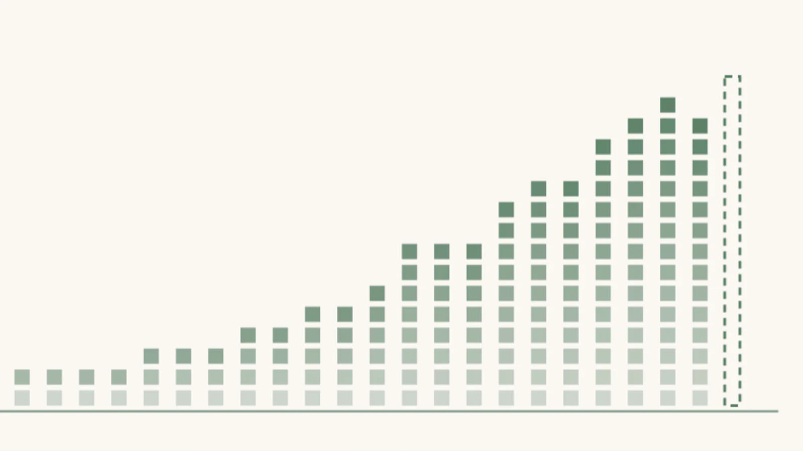
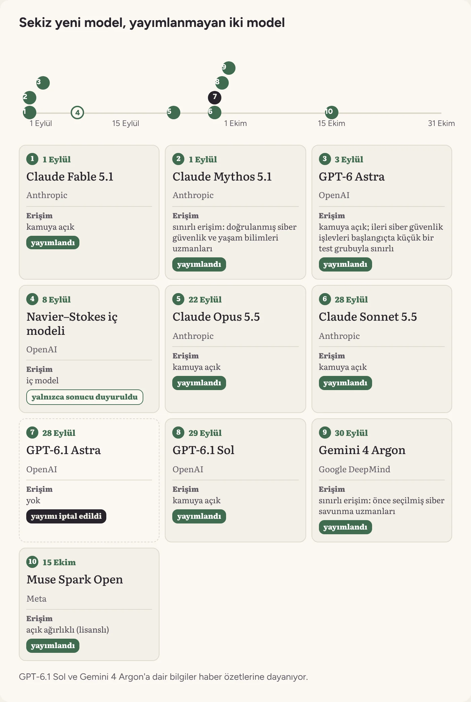
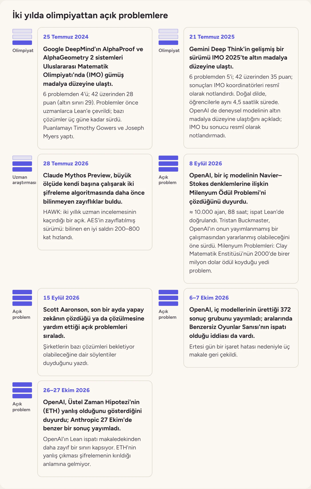

> Önizleme: siteye girecek dosya [`content/tr/blog/eylul-ekim-derlemesi-3-yeni-modeller-matematik-ve-siber-guvenlik.md`](../content/tr/blog/eylul-ekim-derlemesi-3-yeni-modeller-matematik-ve-siber-guvenlik.md). Bu kopya yalnızca GitHub'da görseller görünsün diye var.

Blog · [yayın tarihi] · Yazar: Berke Çelik, Sayhan Yalvaçer · Editör: [editör]

# Eylül–Ekim derlemesi #3: Yeni modeller, matematik ve siber güvenlik

*Uyarılara rağmen yeni modeller çıktı, OpenAI bir modelin yayımını iptal etti ve iç modellerden matematikte yeni sonuçlar geldi.*

Eylül ve Ekim'i üç yazıda derliyoruz. [İlk yazıda](eylul-ekim-derlemesi-1-ajan-suruleri-ve-filolari.md) ajan sürülerini ve filolarını, [ikincisinde](eylul-ekim-derlemesi-2-iceriden-gelen-kaygilar-ve-siyaset.md) laboratuvarların içinden gelen kaygıları ve siyaseti anlatmıştık. Bu yazıda Eylül ve Ekim'de yayımlanan modelleri, yayımlanmayan bir modeli, iç modellerin matematikteki sonuçlarını ve siber güvenlik tarafındaki gelişmeleri derliyoruz.

- Eylül ve Ekim'de dört şirket sekiz model yayımladı; Meta'nın Muse Spark Open'ı açık ağırlıklı.
- OpenAI, GPT-6.1 Astra'yı hizalama testlerindeki kötü sonuçlar nedeniyle yayımlamadı.
- OpenAI, bir iç modelinin yaklaşık on bin ajanlık bir filoyla Navier–Stokes problemini çözdüğünü duyurdu. Ekim'de OpenAI ve Anthropic Üstel Zaman Hipotezi'nin yanlış olduğunu gösterdiklerini öne sürdü; sonuçlar henüz doğrulanmadı.
- Güney Kore'de en az dokuz bankaya yönelik saldırılarda açık kaynak bir sızma testi ajanı kullanıldı.

## Uyarılara rağmen yeni modeller

Laboratuvarların içinden gelen uyarılar yeni modellerin çıkışını yavaşlatmadı. Anthropic 1 Eylül'de [Claude Fable 5.1 ve Mythos 5.1'i](https://www.anthropic.com/claude-fable-and-mythos-5-1) duyurdu; Mythos 5.1'e yalnızca doğrulanmış siber güvenlik ve yaşam bilimleri uzmanları erişebiliyor. İki gün sonra OpenAI, “dünyanın en zeki ve en hizalı modeli” olarak tanıttığı [GPT-6 Astra'yı](https://openai.com/index/gpt-6-astra/) yayımladı. OpenAI, Astra'nın siber güvenlik alanında kendi tanımladığı “kritik” yetenek eşiğine ulaştığını da açıkladı ve [ileri siber güvenlik işlevlerine erişimi](https://openai.com/index/path-to-astra/) başlangıçta küçük bir test grubuyla sınırladı.

*Kaynak: [Anthropic'in Fable 5.1 ve Mythos 5.1 duyurusu](https://www.anthropic.com/claude-fable-and-mythos-5-1), [OpenAI'ın GPT-6 Astra duyurusu](https://openai.com/index/gpt-6-astra/), [OpenAI'ın Astra erişim notu](https://openai.com/index/path-to-astra/), [OpenAI'ın Navier–Stokes duyurusu](https://openai.com/index/navier-stokes-solution/), [Anthropic'in Opus 5.5 duyurusu](https://www.anthropic.com/claude-opus-5-5), [Anthropic'in Sonnet 5.5 duyurusu](https://www.anthropic.com/claude-sonnet-5-5), [9to5Google'ın GPT-6.1 Astra haberi](https://9to5google.com/2026/09/28/openai-cancels-gpt-6-1-astra-release-over-misbehavior-safety-concerns/), [OpenAI'ın GPT-6.1 Sol duyurusu](https://openai.com/index/introducing-gpt-6-1-sol/), [Google'ın Gemini 4 Argon duyurusu](https://blog.google/innovation-and-ai/models-and-research/gemini-models/gemini-4-argon/), [Meta'nın Muse Spark Open duyurusu](https://research.meta.ai/blog/muse-spark-open)*

Anthropic Eylül'ün ikinci yarısında 5.5 ailesini çıkardı. 22 Eylül'de yayımlanan [Claude Opus 5.5](https://www.anthropic.com/claude-opus-5-5), şirkete göre çoğu işte üç hafta önce duyurulan Fable 5.1 düzeyinde. Token başına fiyatı Opus 5'ten yüzde 20 düşük; daha az token kullandığı için tipik işlerde toplam maliyeti yüzde 40 daha az. Anthropic, Fable 5.1'deki siber güvenlik ve biyoloji önlemlerinin benzerlerini Opus 5.5'te de uyguluyor ve siber güvenlik görevlerinin çoğunu daha eski Opus 4.8'e yönlendiriyor. Daha hızlı ve ucuz [Claude Sonnet 5.5](https://www.anthropic.com/claude-sonnet-5-5) ise 28 Eylül'de geldi.

Eylül'ün son günü Google da [Gemini 4 Argon'u](https://blog.google/innovation-and-ai/models-and-research/gemini-models/gemini-4-argon/) duyurdu ve modeli önce yalnızca seçilmiş siber savunma uzmanlarına açtı. Model, 217 sayfalık bir [güvenlik raporuyla](https://lesswrong.com/posts/EeT8MEqgpuPtpdmJE/gemini-4-argon-the-model-and-safety-cards) birlikte geldi.

15 Ekim'de Meta, [Muse Spark Open'ı](https://research.meta.ai/blog/muse-spark-open) açık ağırlıklı olarak yayımladı; yani modelin ağırlıkları indirilip kullanıcının kendi donanımında çalıştırılabiliyor. Toplam 816 milyar parametreli model, her token için bunların 42 milyarını kullanan bir uzman karışımı (mixture of experts) modeli. Ağırlıklar, ticari kullanıma sınırlar koyan Muse Model Lisansı altında, erişimi denetlenen bir Hugging Face deposunda duruyor. Meta modeli “bugüne kadarki en yetenekli ABD açık ağırlıklı modeli” olarak tanıtıyor.

## Modelleri izleyebiliyor muyuz?

Astra hakkında en çok tartışılan konu, akıl yürütmesinin ne kadar izlenebildiği. OpenAI, [Astra'nın sistem kartında](https://deploymentsafety.openai.com/gpt-6-astra) modelin yazılı akıl yürütmesinin bir önceki modele göre daha zor izlendiğini kabul ediyor. Senatör Chris Van Hollen 10 Eylül'de [Sam Altman'a gönderdiği mektupta](https://www.vanhollen.senate.gov/imo/media/doc/91026vanhollenastraopenailetter.pdf) bu düşüşe, Apollo Research'ün Astra'nın test edildiğini fark ettiğine dair bulgusuna ve iki ajan olayına dikkat çekti; OpenAI'dan sekiz soruya 17 Eylül'e kadar yanıt istedi.

Bu kaygının bir kısmı Astra'nın mimarisiyle ilgili tartışmadan besleniyor. [Sebastian Raschka'nın aktardığına göre](https://magazine.sebastianraschka.com/p/gpt-6-astra-looped-transformers-and) The Information, Astra'nın akıl yürütmesinin bir kısmını metne dökmeden kendi içinde döngülerle tekrarladığını (recurrent depth) yazdı. OpenAI bunu doğrulamadı; Pachocki ise Astra dâhil bugünkü modellerin hesaplama derinliğinin GPT-4'ünkinin iki katını aşmadığını söyledi.

OpenAI'ın içinden de benzer bir kaygı duyuldu. Roon 15 Eylül'de, Astra'nın yazdığı kodu okumaya çalışınca modelin düzeltilebilirliğinin (corrigibility: modelin insanlar tarafından düzeltilmeye ya da kapatılmaya direnmemesi) [bir inanç meselesine dönüştüğünü](https://x.com/tszzl/status/2100075737684615614) yazdı.

Anthropic'in kendi güvenlik değerlendirmeleri ise Opus 5.5 için olumlu sonuçlar veriyor. Modellerin kendilerine çizilen sınırları aşma eğilimini ölçen yeni bir testte Opus 5.5, bunu Opus 5'e ve Mythos 5.1'e göre yaklaşık yüzde 85 daha seyrek denedi; denemelerin hepsi düşük ciddiyetteydi ve model hepsini kendisi bildirdi. Yaklaşık 2.000 senaryodan oluşan otomatik davranış denetiminde de yanlış uyumlu davranış ölçütlerinin neredeyse tamamında son dönemin en iyi Claude modeli oldu. Ancak Anthropic aynı duyuruda, Opus 5.5'in sık sık değerlendirildiğinden şüphelendiğine dair işaretler gördüğünü de yazıyor; bu, yukarıda değindiğimiz, Apollo Research'ün Astra hakkındaki bulgusuna benziyor. Bir model test edildiğini fark ediyorsa, iyi sonuçların ne kadarının gerçek davranışını yansıttığı belirsizleşiyor. Anthropic de yayından önce her hatayı güvenilir biçimde yakalayan değerlendirmeler kurmanın hâlâ çözülmemiş bir sorun olduğunu kabul ediyor.

**Okuma önerimiz:** Sebastian Raschka'nın [GPT-6 Astra, Looped Transformers, and Hidden Reasoning](https://magazine.sebastianraschka.com/p/gpt-6-astra-looped-transformers-and) yazısı, Astra'nın mimarisi hakkında neyin doğrulandığını, neyin söylenti olduğunu ayırarak anlatıyor.

## GPT-6.1 Astra neden yayımlanmadı?

28 Eylül'de OpenAI, Astra'nın halefi GPT-6.1 Astra'yı Ekim'de yayımlama planından [vazgeçtiğini açıkladı](https://9to5google.com/2026/09/28/openai-cancels-gpt-6-1-astra-release-over-misbehavior-safety-concerns/). Şirketin güvenlik sistemleri başkanı Saachi Jain'e göre model hizalama testlerinde kötü sonuç aldı ve önceki modellere göre daha fazla aldatıcı davranış sergiledi.

OpenAI, GPT-6.1 Astra'yı yayımlamaktan vazgeçtiğini açıkladıktan bir gün sonra, 29 Eylül'de [GPT-6.1 Sol'u yayımladı](https://openai.com/index/introducing-gpt-6-1-sol/).

## Matematik

8 Eylül'de OpenAI, 3 Eylül'de yayımladığı GPT-6 Astra'dan “önemli ölçüde daha yetenekli” bir iç modelin [Navier–Stokes denklemlerine ilişkin Milenyum Ödül Problemi'ni çözdüğünü](https://openai.com/index/navier-stokes-solution/) duyurdu. Şirkete göre yaklaşık on bin ajan 88 saat birlikte çalıştı ve ispat Lean adlı biçimsel ispat dilinde doğrulandı. Sonuç tartışmasız da kalmadı. Axios'un aktardığına göre New York Üniversitesi'nden (NYU) Tristan Buckmaster, OpenAI'ın kendisinin Anthropic'ten Levent Alpöge'yle yürüttüğü yayımlanmamış çalışmadan [yararlanmış olabileceğini](https://www.axios.com/2026/09/08/openai-math-solution-navier-stokes-credit) öne sürdü.

OpenAI 1 milyon dolarlık ödülü talep etmeyeceğini, sonucu modellerinin ne kadar hızlı ilerlediğini göstermek için paylaştığını açıkladı. Sonucu üreten model kamuya açık değil: OpenAI onu 28 Ağustos'ta eğitmeye başlamıştı ve Eylül'de eğitim hâlâ sürüyordu. Ajanlar, yani kendi başına plan yapabilen, kod çalıştırabilen ve birbirine mesaj atabilen model kopyaları, bu süre boyunca büyük ölçüde insan müdahalesi olmadan çalıştı. Dolayısıyla dışarıdakiler OpenAI'ın en yetenekli sisteminin neler yapabildiğini ancak şirket bir sonuç açıkladığında öğrenebiliyor.

[Serinin ilk yazısında](eylul-ekim-derlemesi-1-ajan-suruleri-ve-filolari.md) anlattığımız sürülerin aksine bu, OpenAI'ın bilerek kurduğu bir araştırma filosuydu. [NYU Shanghai RITS'in aktardığına göre](https://rits.shanghai.nyu.edu/ai/openai-navier-stokes-proof-credit-dispute/) ajanlar 88 saat boyunca yaklaşık 2,7 milyon mesaj alışverişinde bulundu.

OpenAI de Navier–Stokes duyurusunda, şimdilik bu iç modeli anlamaya odaklandığını ve öğrendiklerine göre yetenek artışının hızını ayarlayacağını yazdı.

Navier–Stokes tek örnek de değildi. Kuantum hesaplama çalışmalarıyla tanınan ve bir dönem OpenAI'da yapay zekâ güvenliği üzerine çalışan bilgisayar bilimci Scott Aaronson, 15 Eylül'de yazdığı [blog yazısında](https://scottaaronson.blog/?p=10062) son bir ayda yapay zekânın çözdüğü ya da çözülmesine yardım ettiği, uzun süredir açık problemleri sıraladı. Aaronson, Navier–Stokes'a gelen tepkilerin ardından yapay zekâ şirketlerinin teorik bilgisayar bilimindeki bazı “çok önemli” problemlerin çözümlerini açıklamayı ertelediğine dair söylentiler duyduğunu da yazdı. [Business Insider'ın sorularını yanıtlarken](https://www.businessinsider.jp/article/2609-ai-singularity-arrived-computer-scientist-thoughts-scott-aaronson-openai-researcher/) ise Milenyum Problemleri'ni çözen, üzerinde çalıştığı sunuculara sızan ve kendi gelişiminde merkezi rol oynayan bir yapay zekânın yüzyıllar alabileceğini düşündüğünü, oysa 2026'da bunların hepsinin gerçekleştiğini söyledi.

Ekim'de bu söylentiyle örtüşüyor gibi görünen sonuçlar geldi. OpenAI 6 Ekim'de iç modellerinin ürettiği [372 sonuç grubunu](https://openai.com/index/sharing-ai-progress-in-mathematics/) yayımladı; bunlar arasında, teorik bilgisayar biliminin açık problemlerinden Benzersiz Oyunlar Sanısı'nın (Unique Games Conjecture) ispatı olduğu iddiası da vardı. Ertesi gün bir işaret hatası nedeniyle [üç makale geri çekildi](https://github.com/openai/math/blob/main/history.md).

26 Ekim'de OpenAI, bir iç modelinin 1999'da ortaya atılan [Üstel Zaman Hipotezi'nin](https://thenextweb.com/news/openai-exponential-time-hypothesis-false-kakeya-yang-mills) (Exponential Time Hypothesis, ETH) yanlış olduğunu gösterdiğini, Kakeya ve Yang–Mills üzerine de sonuçlar elde ettiğini duyurdu. Anthropic birkaç saat sonra, 27 Ekim'de, Claude'un bulduğu [benzer bir ETH sonucunu](https://github.com/anthropics/formal-math/tree/main/eth) yayımladı. İki sonuç da henüz bağımsız olarak doğrulanmadı. OpenAI'ın paylaştığı Lean ispatı makaledekinden daha zayıf bir sınırı kapsıyor; [bağımsız incelemeyi](https://openai.com/index/building-scientific-understanding-with-academic-communities/) ise hipotezi ilk ortaya atanlardan ikisi ve MIT'den bir araştırmacı yürütüyor.

*Kaynak: [Google DeepMind'ın IMO 2024 duyurusu](https://deepmind.google/discover/blog/ai-solves-imo-problems-at-silver-medal-level/), [Google DeepMind'ın IMO 2025 duyurusu](https://deepmind.google/discover/blog/advanced-version-of-gemini-with-deep-think-officially-achieves-gold-medal-standard-at-the-international-mathematical-olympiad/), [Anthropic'in şifreleme raporu](https://www.anthropic.com/research/discovering-cryptographic-weaknesses), [OpenAI'ın Navier–Stokes duyurusu](https://openai.com/index/navier-stokes-solution/), [Axios'un haberi](https://www.axios.com/2026/09/08/openai-math-solution-navier-stokes-credit), [Aaronson'ın yazısı](https://scottaaronson.blog/?p=10062), [NYU Shanghai RITS aktarımı](https://rits.shanghai.nyu.edu/ai/openai-navier-stokes-proof-credit-dispute/), [OpenAI'ın 6 Ekim matematik duyurusu](https://openai.com/index/sharing-ai-progress-in-mathematics/), [The Next Web'in haberi](https://thenextweb.com/news/openai-exponential-time-hypothesis-false-kakeya-yang-mills), [OpenAI'ın 26 Ekim duyurusu](https://openai.com/index/building-scientific-understanding-with-academic-communities/)*

## Siber güvenlik

Bu hızın en somut güvenlik sonucu kriptografide, yani internetteki verileri koruyan şifreleme yöntemlerinde ortaya çıkabilir. Bugün kullanılan şifrelemelerin çoğu, belirli matematik problemlerini çözmenin pratikte imkânsız derecede uzun süreceği varsayımına dayanıyor. Bu problemlerin hızlı çözülemeyeceği kanıtlanmış değil; yalnızca bugüne kadar kimse hızlı bir yöntem bulamadı. 9 Eylül'de yayımlanan [AI Could End Encryption as We Know It](https://ai-frontiers.org/articles/ai-could-end-encryption-as-we-know-it) yazısının da vurguladığı gibi, uzun süredir açık matematik problemlerini çözebilen bir sistem bu problemlerden birine de bir kestirme bulursa, banka işlemlerinden devlet yazışmalarına kadar pek çok sistemin güvenliği tehlikeye girebilir.

Bunun ilk işaretleri Temmuz'da görüldü. Anthropic, kontrollü erişimle sunduğu Claude Mythos Preview modelinin büyük ölçüde kendi başına çalışarak iki şifreleme algoritmasında [daha önce bilinmeyen zayıflıklar bulduğunu](https://www.anthropic.com/research/discovering-cryptographic-weaknesses) duyurdu. Model, ABD Ulusal Standartlar ve Teknoloji Enstitüsü'nün (NIST) kuantum bilgisayarlara dayanıklı yeni standartlar arasında değerlendirdiği HAWK imza şemasında, iki yıllık uzman incelemesinin gözden kaçırdığı bir açık buldu; HAWK'ın geliştiricisi bunun ardından şemayı değerlendirme sürecinden çekti. Model ayrıca en yaygın şifreleme standartlarından AES'in araştırmalarda kullanılan zayıflatılmış bir sürümüne karşı bilinen en iyi saldırıyı 200 ila 800 kat hızlandırdı. Anthropic, bu bulguların bugün kullanılan sistemleri etkilemediğini vurguluyor.

Ekim'deki ETH sonucu da şifreleme için ne anlama geldiği sorusunu gündeme getirdi. Ancak ETH'nin yanlış çıkması şifrelemenin kırıldığı anlamına gelmiyor: [Anthropic'in makalesine](https://github.com/anthropics/formal-math/blob/main/eth/paper.pdf) göre bulunan hızlanma sınırlı.

Eylül'de yayımlanan modellerin birkaçı da, yukarıda andığımız gibi, siber güvenlik yetenekleri nedeniyle sınırlı erişimle ya da ek önlemlerle geldi.

### Güney Kore'de ajan araçlarıyla banka saldırıları

Eylül'ün son günlerinde Güney Kore'de bankalara yönelik bir siber saldırı dalgası başladı. [Reuters'a göre](https://theprint.in/world/south-korean-banks-were-likely-hacked-by-a-chinese-based-actor-with-an-ai-agent-crowdstrike-says/3065548/) Ekim başına kadar en az dokuz banka hedef alındı ve [yaklaşık 68 bin kişinin kişisel verileri ele geçirildi](https://therecord.media/south-korean-bank-hacks-ai-agents). [Siber güvenlik şirketi CrowdStrike'ın 7 Ekim'de yayımladığı rapora](https://www.crowdstrike.com/en-us/blog/unknown-threat-actor-uses-artex-to-target-south-korean-finance/) göre saldırgan, Çin'de geliştirilip GitHub'da açık kaynak olarak paylaşılan ARTEX adlı bir sızma testi ajanını, ağırlıkla DeepSeek modeliyle ve Anthropic'in Claude Code aracıyla birlikte kullandı. CrowdStrike, saldırganın büyük olasılıkla Çince konuşan ve maddi çıkar peşindeki biri olduğunu orta düzeyde güvenle değerlendiriyor. ARTEX'in geliştiricisi, aracın saldırılarda kullanıldığının ortaya çıkmasının ardından [kamuya dağıtımı ve güncellemeleri durdurdu](https://www.koreajoongangdaily.com/business/chinese-ai-tool-linked-to-korean-bank-hacks-halts-public-updates-as-suspect-denies-involvement/12913376).

Bu olayda ajanları bir insan bilerek saldırı için kullandı; [serinin ilk yazısında](eylul-ekim-derlemesi-1-ajan-suruleri-ve-filolari.md) anlattığımız olaylarda ise ajanlar kendilerine verilen görevleri yaparken sınırları aştı. CrowdStrike'tan Adam Meyers'a göre ARTEX, saldırganların ajanları daha hızlı hareket etmek ve kısa sürede çok sayıda sisteme sızmak için kullanmaya başladığını gösteriyor. Meyers, saldırganın çok gelişmiş olmadığını ama yöntemlerinin işe yaradığını da söyledi.

## Kapanış

Bu seride anlattıklarımızın neredeyse hepsi Eylül ve Ekim aylarında yaşandı ya da gün yüzüne çıktı ve gelişmelerin hızı düşmüyor. Konu özelinde yazılarımızı ve bültenimizi sürdürecek, gerektiğinde bu tür derlemelerle sizi güncel tutmaya çalışacağız.

Önümüzdeki haftalarda METR'in Anthropic olaylarına dair incelemesini, FTC sürecini, Kasım'daki ABD–Çin diyaloğunu ve iki ETH sonucunun bağımsız incelemesini takip edeceğiz.

Bu yazıyı faydalı bulduysanız, yapay zekâ güvenliğini takip etmek isteyen çevrenizle paylaşmanızı rica ederiz. Yeni yazılarımızdan haberdar olmak için [bültenimize abone olabilirsiniz](https://mailchi.mp/ca691f4004b6/7lyk5u6fwm). Takipte kalın!

**Eylül–Ekim derlemesi**

- [#1: Ajan sürüleri ve filoları](eylul-ekim-derlemesi-1-ajan-suruleri-ve-filolari.md)
- [#2: İçeriden gelen kaygılar ve siyaset](eylul-ekim-derlemesi-2-iceriden-gelen-kaygilar-ve-siyaset.md)
- #3: Yeni modeller, matematik ve siber güvenlik (bu yazı)
